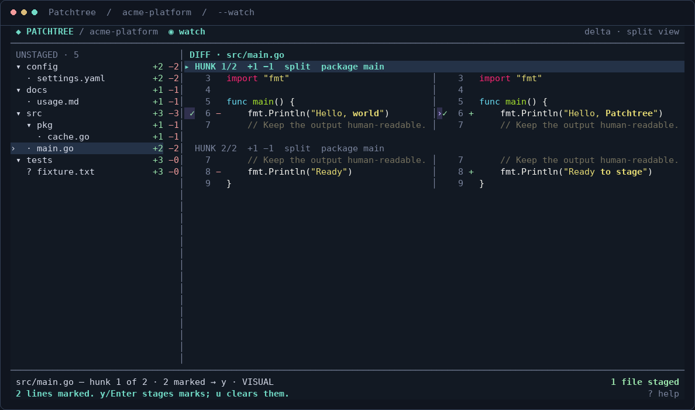

# Patchtree

**File-tree navigation. Hunk- and line-sized staging.**

A Go / Bubble Tea TUI for reviewing unstaged changes and putting only the changes you choose into Git's index. It combines a collapsible, diffnav-style tree with `git add --patch`-style actions. It does **not** commit, reset, discard worktree changes, or manage branches/remotes.



The screenshot is from an actual pseudo-terminal session against a small fixture repository.

## Build and run

Requirements:

- **Go 1.24 or newer** (dependencies are pinned in `go.mod` / `go.sum`).
- **Git** on `PATH` and an interactive terminal.
- **[delta / git-delta](https://github.com/dandavison/delta)** on `PATH` for syntax and intraline highlighting. A recent release is recommended; integration was tested with delta **0.20.1**. If delta is missing or fails, the app continues with basic addition/deletion colors.
- A terminal at least **64 columns × 12 rows**. Approximately 120 columns is comfortable for side-by-side mode. The palette is designed for a dark terminal.

Added and removed lines carry a full-width green/red background across gutter,
code and padding in either layout. Selection replaces the change tint.

Install delta with your package manager, or for example:

```sh
brew install git-delta                 # macOS / Homebrew
# Or, with Rust installed:
cargo install git-delta --locked
```

Inside the extracted `patchtree` source directory:

```sh
go build -o patchtree .
./patchtree /path/to/your/repository

# Automatically reread changes every 1.5 seconds:
./patchtree --watch /path/to/your/repository

# Start with side-by-side diffs and poll every two seconds:
./patchtree --watch --watch-interval=2s --side-by-side /path/to/repository

# Basic renderer, without delta:
./patchtree --no-delta /path/to/repository
```

Omit the repository argument to use the current directory; a subdirectory of a repository works too. Put flags **before** the optional directory argument.

Development / installation alternatives:

```sh
go run . --watch /path/to/repository  # Use '.', not just 'main.go'.
go install .                        # Installs into GOBIN or GOPATH/bin.
make build                          # Optional convenience targets below.
```

## A quick staging workflow

1. Move around the tree with `j` / `k` or arrows. Moving onto a file previews it.
2. Press `Enter` on a directory to collapse/expand it, or on a file to focus its diff.
3. Use `y` to stage the active hunk; `n` skips it without changing Git.
4. Use `s` in the **diff** to split a hunk at context gaps. Use `S` to change the diff layout.
5. For lines: `V` starts a range, `J` / `K` extends it, and `Space` marks/unmarks changed lines. `y` or `Enter` applies the marks.
6. The tree, diff, staged-file count, and active hunk refresh **without exiting**. A fully staged file disappears from the unstaged tree.
7. `q` exits, leaving already-staged changes in place. Inspect them with `git diff --cached` afterward.

> **Marks are a review queue, not immediate index changes.** `Space` never applies a patch. When any lines are marked, `y` stages **all marked changed lines in the current file**, instead of the whole active hunk. This batching lets you select both sides of a replacement before applying it.

## Keybindings

Two requested bindings conflict between navigation and patching. They are resolved by **pane focus**:

- `n`: next **file** in the tree; skip this **hunk** in the diff.
- `s`: toggle diff **layout** in the tree; **split hunk** in the diff.
- `N` / `P` always navigate files; `S` always toggles layout.

The focused pane's title is accented. `Tab` changes focus; `?` opens the complete help overlay.

### Global

| Key | Action |
| --- | --- |
| `Tab`, `Shift+Tab` | Switch tree/diff focus |
| `/` | Start case-insensitive, substring filename search |
| `Esc` | Cancel live search; leave visual mode; clear accepted search; or return to tree, in that order |
| `N`, `P` | Next/previous matching file; wrap at the ends and reveal its parents |
| `S` | Toggle unified / side-by-side diff layout |
| `r` | Refresh changes and the actual staged-file count |
| `f` | Stage the whole selected **file**, including modes, via `git add -A` |
| `?` | Toggle help; `j` / `k` scroll help on a small terminal |
| `q`, `Ctrl-c` | Quit without staging anything else |

While search is being typed, ordinary characters—including `q`, `n`, and `s`—are search text, not commands. Up/down chooses a result; `Enter` accepts the filter and opens a selected file. A search temporarily reveals matching directories **without losing their collapsed state**. `Esc` clears it.

### Tree focus

| Key | Action |
| --- | --- |
| `j` / `k`, down/up | Move through visible tree rows; auto-preview files |
| `Enter` | Toggle a directory, or open a file and focus its diff |
| `h` / `l`, left/right | Collapse / expand directories, move to parent / child, or focus a file's diff |
| `n` / `p` | Next/previous file |
| `s` | Toggle the diff layout |
| `g` / `G`, Home/End | First/last visible tree row |

Each text file has addition/deletion stats; directories aggregate their children. `?` marks an untracked file, `B` a binary file, and `!` an unmerged path. Directory collapse, cursor paths, and tree scroll position survive staging/refreshes within the session.

### Diff focus: navigation and staging

| Key | Action |
| --- | --- |
| `j` / `k`, down/up | Move the source-line cursor |
| `Ctrl-d` / `Ctrl-u`, PageDown/PageUp | Scroll a half page; keep the active hunk on screen |
| `h` / `l` | Pan long lines horizontally, eight columns at a time |
| left/right | Select the old/new side of a paired row in side-by-side mode; pan in unified mode |
| `[` / `]` | Previous/next hunk without skipping it |
| `p` | Previous hunk |
| `g` / `G`, Home/End | First/last hunk |
| `y` | Stage this hunk, or all marked lines in this file if marks exist |
| `n` | Mark this hunk skipped and advance; at the last hunk, advance to the next file |
| `s` | Split this hunk into separate change groups when there is a context gap |
| `e` | Edit the current hunk/marked patch in an external editor, then apply the saved patch |
| `a` | Stage this hunk and every subsequent hunk in the file; earlier hunks remain unstaged |
| `d` | Skip this hunk and all subsequent hunks; advance to the next file |
| `f` | Stage the whole file, including any mode change |

Skipped hunks stay visible, with a `skipped` label. You can return to one and stage it later. Skipping is navigation/session state: it never discards, reverts, or stages a change. Splits and skips are remembered for unchanged files when navigating away and back; a changed diff is reparsed.

Side-by-side mode falls back to unified on a narrow terminal while retaining the requested layout. Lines are clipped, not wrapped, so gutters and selections stay aligned; use horizontal panning for long lines.

### Diff focus: individual lines

| Key | Action |
| --- | --- |
| `V` | Enter/leave visual line-range mode |
| `J` / `K` (`Shift+j` / `Shift+k`) | Start or extend a range down/up; Shift+arrow equivalents also work |
| `Space` | Mark/unmark the changed lines in the range, or the current changed line |
| `y`, `Enter` | Apply marked lines through `git apply --cached` |
| `u` | Clear every pending line mark without staging |
| `Esc` | Leave visual mode, retaining marks |

`›` is the cursor; `✓` is a marked line. Context lines cannot be staged. Visual ranges stay inside the current selectable hunk. In side-by-side mode, left/right lets you select only the deletion or only the addition on the same row.

Ranges and partial replacements follow **raw patch order**: retaining an unselected deletion turns it into context, while selected additions keep their relative patch order. Partial line selections can therefore create an intermediate file that is not valid source code; inspect `git diff --cached`, or use `e` if you need a custom arrangement.

Switching to another file clears unapplied marks, with a notice. A watch refresh preserves them when the diff is unchanged; if the file/index changed, stale marks are cleared and you are asked to review the new preview. `a` stages entire current/remaining hunks, regardless of line marks.

## External editor

Editor lookup is `GIT_EDITOR`, then `VISUAL`, then `EDITOR`, then `vi`. Quoted executable names and arguments are supported; shell pipelines/operators are **not** evaluated.

```sh
EDITOR=nvim ./patchtree
VISUAL='code --wait' ./patchtree --watch /path/to/repository
```

Bubble Tea releases the terminal for the editor and restores it afterward. GUI editors need a blocking/wait option.

The temporary patch includes editing instructions:

- Remove a `+` line to omit that addition.
- Change a `-` prefix into a space to retain that old line.
- Counts are recounted automatically. If removing leading context or editing boundaries, adjust the **old** start coordinate; new coordinates are recomputed against the projected index.
- Do not edit file headers or modes, and do not add another file's patch. These changes are rejected.
- Retaining lines from a deleted file automatically converts deletion metadata into an ordinary modification patch.
- **Empty the patch to cancel**, or make the editor exit unsuccessfully (`:cq` in Vim). Closing the editor successfully with an unchanged patch stages the original selection.

Edited patches must pass Git's cached-index check before anything is applied. Malformed/stale patches display an error and leave you in the TUI.

## Architecture and patch correctness

| File | Responsibility |
| --- | --- |
| `main.go` | CLI, Bubble Tea `Model`, focus-aware `Update`, asynchronous Git/delta messages, watch timer, editor handoff |
| `git.go` | Repository discovery, read-only snapshots, diff/hunk parsing, selected-line projection, editor validation, cached-index application |
| `ui.go` | Hierarchical tree, hunk splitting, delta adapter, source-to-screen mapping, both diff layouts, viewport, status/help rendering |
| `*_test.go` | Parser, real-Git integration, patch projection, model/keybindings, renderer and edge-case tests |

### Reading changes

Tracked changes come from `git diff --no-color --no-ext-diff --no-textconv --no-renames --unified=3`, **against the current index**, not against HEAD. Explicit prefixes and submodule format make parsing independent of Git presentation settings. NUL-delimited `ls-files` output handles unusual names and distinguishes untracked files and unmerged index stages.

Untracked regular files use `git diff --no-index /dev/null <path>` from the repository root. Merely opening the app does **not** create intent-to-add entries. New repositories without a HEAD commit are supported. Git's normal text conversion applies to the diff; tests include CRLF normalization.

### Rendering

Raw patches are passed through delta with `--color-only --no-gitconfig --paging=never --dark` and a Monokai Extended syntax theme. Explicit dark mode prevents delta's background-color detection from reading `/dev/tty` and competing with Bubble Tea for keystrokes.

Delta colors the source; Patchtree owns line numbers, gutters, hunk headers, clipping, and side-by-side pairing. This makes selection mapping reliable. The adapter checks that delta preserved line count **and content**; incompatible output falls back safely. Repository control characters are escaped for display, while original bytes are preserved for patch application.

### Applying a selection

For every selected source hunk, the patch builder:

1. Keeps selected additions and deletions.
2. Omits unselected additions and converts unselected deletions into context.
3. Recounts old/new lengths and derives new starts using **only the net selected changes in preceding hunks**.
4. Retains EOF/no-newline markers. A selection that would put an unterminated EOF line inside the new file is rejected; select the entire final replacement instead.
5. Retains new-file metadata; removes deletion metadata for a partial deletion. Selecting the entire deleted file removes its index entry.

Split hunks point back to original source lines. Applying several splits unions their selected lines into the original hunk, avoiding overlapping-context/double-application errors. Hunk/line staging of an existing file does not implicitly stage its executable-bit change; `f` explicitly does.

The patch is written to a private temporary file, checked with `git apply --cached --check --whitespace=nowarn`, then applied with `git apply --cached --whitespace=nowarn`. The worktree is untouched. A fresh fingerprint check rejects a file/index that changed since preview; Git also validates context and acquires its normal index lock during application. External tools can still race any Git stager, so application failures are surfaced and never blindly retried.

Whole-file staging uses literal pathspecs and `git add -A -- <path>`. No user pathname is interpolated into a shell command.

### Refresh and status

All Git reads/staging and delta highlighting are asynchronous commands returning typed Bubble Tea messages. Epochs prevent an older watch read from resurrecting already-staged changes. Polling reads do not overlap, and mutations temporarily disable further staging keys. Resizes, help, errors, and normal refreshes stay in the same TUI.

The staged counter is the number of distinct file paths in **`git diff --cached` relative to HEAD**. It includes changes staged before launching the app, not just this session's actions. A file remains counted after it disappears from the unstaged tree. Watch mode also detects index changes made by other tools.

## Scope and limitations

- Binary files, symbolic links, empty files, mode-only changes, file-type changes, and submodule pointers require **whole-file `f` staging**. They are not treated as editable text hunks.
- `f` on a submodule/embedded repository stages its recorded commit only, **not files inside it**. Dirty-only submodule contents can remain listed; work in that repository to stage those contents. An embedded repository with no commit must be handled there first.
- Unmerged paths are shown but protected: resolve conflicts outside this tool.
- Renames are intentionally shown as separate deletion/addition entries, not inferred rename patches.
- Ignored untracked files are excluded. A deleted untracked file has no index entry to stage; it is outside the tool's scope.
- Collapse/skip/split state is session-local, not persisted to disk. There is no commit interface or unstage command.
- Large repositories with many untracked files may benefit from `.gitignore` and a longer `--watch-interval`; each poll rereads the raw diff and previews untracked files.
- Quitting does not undo already-staged changes. During an active index write, wait for it to finish before pressing `q` again.

## Flags

```text
patchtree [flags] [repository-directory]

--watch                  Poll changes; off by default
--watch-interval=1.5s     Polling interval; minimum 100ms
--side-by-side           Start in split mode; unified by default
--no-delta               Use the built-in basic-color renderer
--version                Print version and exit
--help                   Show CLI usage
```

## Tests

```sh
go test ./...
go test -race ./...
go vet ./...

# Optional parser fuzzing:
go test -fuzz=FuzzParseDiff -fuzztime=10s

# Convenience:
make check
```

Repository-backed tests create isolated temporary repositories; they never reset or modify your repository. Coverage includes full/partial replacements, multi-hunk coordinate shifts, new/deleted/empty files, intent-to-add, pre-existing staged content, shared split context, mode preservation, EOF/CRLF, Unicode/quoted/control-character filenames, binary/link/conflict protection, stale previews, editor validation, watch-state preservation, focus conflicts, layout bounds, and **100 deterministic random line-selection masks** checked against the real index.

The real delta integration test runs when `delta` is on `PATH`; otherwise that test is explicitly skipped. Backend-argument and fallback tests do not require delta. The app has also been exercised in an actual pseudo-terminal through search, split, visual marks, both layouts, partial staging, watch refresh, continued staging, **external-editor handoff and manual patch application**, and quit.

Verified on Linux with Go **1.25.1**, Git **2.47.3**, and delta **0.20.1**: build, full test suite, race detector, `go vet`, and a ten-second parser fuzz run (over 320,000 inputs).
